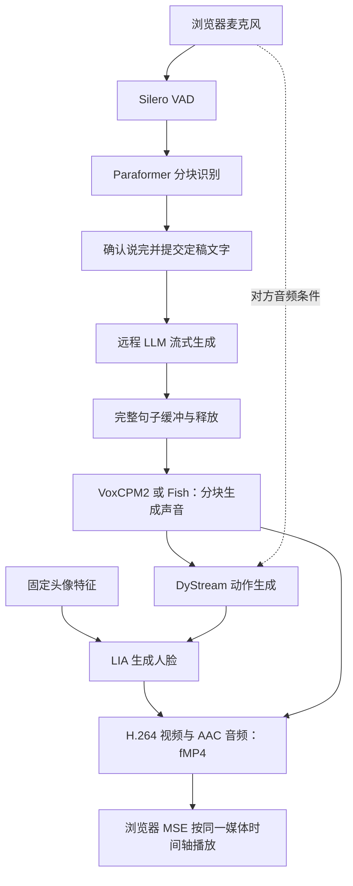

# OpenVA-Dialogue：模型、推理与优化说明

> 2026-11-01 补充：服务器旧基线已完成真实中文对话与浏览器播放测试，见[服务启动记录](docs/server_bootstrap_20261101.md)。
> 当前运行 LLM 已按用户要求切为 `qwen3.8-flash`（关闭思考），实际中文对话验证通过。
> 本地优化尚未整体移植；下文的优化证据边界与 12 GiB 未验收结论保持不变。

整理日期：2026-10-31。依据本地代码提交 `27997a2c98c468a1af90c79dd51268ea68b8478f`
及仓库中的测量记录。本文件汇总本次工作的模型组成、推理流程、基础设施优化、实测依据与 TODO；
具体安装步骤见 [中文主 README](README_zh-CN.md) 和 [单卡部署说明](docs/single_gpu_4090.md)。

**当前结论：两个经过组件验证的渲染显存开关已在源码默认启用；优化后的整套服务显存尚未实测，
12 GiB 目标尚未验收，也没有确认整段对话延迟降低了多少。**

## 1. 系统与模型组成

OpenVA-Dialogue 将语音对话和音频驱动数字人接成一套可打断的系统。
本轮工作使用既有模型做推理与基础设施优化，没有重新训练、蒸馏模型或实现投机解码。

| 环节 | 模型 / 组件 | 职责 |
| --- | --- | --- |
| 语音活动检测 | Silero VAD | 判断开始说话、停止说话，触发轮次和插话事件 |
| 语音识别 | Paraformer 流式 ASR | 一边接收麦克风音频一边识别，结束时提交定稿文字 |
| 对话 | 兼容 OpenAI API 的远程 LLM | 根据当前提问和历史上下文，流式生成回答；具体型号由实例配置决定 |
| 语音合成 | 单卡方案 VoxCPM2；原有多卡方案 Fish Speech S2 Pro | 根据参考声音及逐字稿生成克隆音色，分块返回 PCM |
| 音频特征 | Wav2Vec2 及 DyStream 双音频分支 | 分别处理自己的声音与对方的声音，作为动作条件 |
| 动作生成 | DyStream motion | 根据声音与递归状态生成面部、头部动作表示 |
| 人脸生成 | LIA：头像编码器、FlowEstimator、FaceGenerator | 从固定头像提取特征，结合动作生成原生 512×512 画面 |
| 编排与交付 | Pipecat、AV2AV 引擎、FFmpeg、浏览器 MSE | 管理轮次、取消、音画同步、编码和播放 |

参考输入是一张正脸图、短参考录音及匹配逐字稿。当前已测试的对话输入是麦克风音频；
不能由此宣称具备摄像头视觉理解能力。项目不是全离线本地大模型系统，LLM 使用远程 API。
另保留 `native_s2s` 原生语音到语音路线；下文的 ASR→LLM→TTS 流程指 `custom_cascade`。

## 2. 一轮对话怎样运行



- 用户说话期间 ASR 已经工作，通常在确认本轮结束后才将定稿文字交给 LLM。
- LLM 不必生成完整回答才进入 TTS，但当前实现一般要等出一句完整的话。
- TTS 音频分块到达后驱动动作和画面。可以第一句话已经播放，后面的话还在生成。
- Listener 与 Speaker 使用同一个 DyStream 递归模型及连续状态，不是两个独立 checkpoint。
  Speaker 使用自己的语音条件；Listener 使用对方音频条件。
- 插话会取消旧回复、处理短尾音并阻止旧队列数据回流。正常换轮不重新加载人物模型。

代码入口：[对话组件](pipecat_dystream/custom_cascade.py)、[流式 ASR](pipecat_dystream/funasr_streaming.py)、
[LLM 文本释放](pipecat_dystream/resilient_llm.py)、[TTS 适配器](pipecat_dystream/voxcpm2_tts.py)、
[会话连接](pipecat_dystream/mse_session.py)、[连续媒体引擎](server_mse.py)。

## 3. 部署与模型来源

| 方案 | GPU 布局 | 说明 |
| --- | --- | --- |
| 单张 RTX 4090 | DyStream、LIA、官方 VoxCPM2 共用一张卡 | ASR 在 CPU，LLM 用 API；已有历史完整对话记录 |
| 原有 Fish 多卡 | 两张 DyStream/LIA 卡，另两张 Fish 卡 | Fish 引擎和 vocoder 使用独立 GPU；两组不重叠 |
| 本机优化验证 | RTX 4060 Laptop，8188 MiB | Windows 下做 CUDA 组件测试与源码重放，没有运行完整模型服务 |

| 模型 | 本次使用的来源 / 固定版本 | 校验与范围 |
| --- | --- | --- |
| DyStream motion 与 LIA | `robinwitch/DyStream`，`9ad5b1d3b0ef7aece4b9855d972c1f819f04dfbb` | 见权重清单；本机已验证完整 LIA 文件，未加载完整 motion 训练权重 |
| Wav2Vec2 | `facebook/wav2vec2-base-960h`，`22aad52d435eb6dbaf354bdad9b0da84ce7d6156` | 模型下载清单锁定版本；不代表已验证运行中所有权重 |
| VoxCPM2 权重核查 | `openbmb/VoxCPM2`，`32279effe8c19989596f05d353d1447f51d9e915` | 本机核查配置、权重头部及完整文本词表，未下载并校验整个模型文件 |
| VoxCPM 实现核查 | `OpenBMB/VoxCPM`，`cce58a5b59303c9bd63d12f23afe6a49a4a80c59` | AudioVAE、prefill 与 KV 实现依据；目标运行环境仍须匹配版本 |
| Fish S2 Pro | `fishaudio/s2-pro`，`1de9996b6be38b745688de084d87a5633f714e4e` | 原有多卡方案，详情见权重清单和部署文档 |

[weights-manifest.json](weights-manifest.json)记录下载位置、版本及可用校验值；
其中空校验值不表示已经验证文件。LIA 完整 checkpoint 的 SHA-256 为
`a9f06f55912dfa12ea18d77315f1c1675c5f67669097db8f155b4a4d75f9d31d`。
私有头像、声音、凭据和权重文件不提交 Git。项目及各上游的使用许可分别见
[许可证状态](LICENSE_STATUS.md) 与 [第三方声明](THIRD_PARTY_NOTICES.md)。

## 4. 已完成的推理与基础设施优化

本轮优先减少重复计算、重复存储和无用驻留，不通过量化、降分辨率、减少去噪步数或换小模型获取收益。
“数值一致”只覆盖对应测量输入及组件，不自动扩展为完整系统感知效果验收。

| 改动 | 做了什么 | 当前状态 / 验证 |
| --- | --- | --- |
| 头像编码器用后卸载 | 提取头像动作锚点、外观特征后，将 MotionEncoder、FaceEncoder 移回 CPU，并释放源图 GPU 临时张量 | 已接入；生产类、随机 FP32 权重 CUDA 输出对照误差 0 |
| 动作模块选择性加载 | 不参与 forward 的层留 CPU；逐元素相同的位置表共享存储 | 单卡且 EMA 已折叠的适用路径生效；保留旧 EMA 路径；GPT Graph 13 组输出误差 0 |
| SPADE 临时存储复用 | 缩短局部张量生命周期，在无梯度 eval 中复用内部结果 | 已接入；保留原加乘顺序，随机权重渲染输出误差 0，训练/梯度路径保留 |
| AudioVAE 编码器卸载 | 参考音频特征缓存后 encoder 移 CPU；再次 encode 自动重载 | 官方 VoxCPM2 适用路径生效；随机权重波形及重新编码特征误差 0 |
| 解码器 weight_norm 缓存 | 固定有效权重留 GPU，原始参数移 CPU；参数/设备/dtype 变化时失效 | 已接入；checkpoint 兼容，训练/梯度路径回退；完整训练模型语音仍待验收 |
| 渲染器固定计算缓存 | 复用 Direction 的 QR 基、标准化卷积权重、设备网格，减少重复算与传输 | 已接入 eval 无梯度路径；这是用部分常驻缓存换计算，不属于省显存项 |
| 谱归一化缓存 | 18 层复用固定有效权重，原始状态留 CPU | **默认启用**；真实 LIA 权重下组件输出逐位一致 |
| 渲染中间结果提前释放 | 最后使用后删除翘曲特征等局部引用 | **默认启用**；真实 LIA 权重下组件输出逐位一致 |
| 时间步与媒体复制 | 避免 timestep 隐式标量读取，去除 uint8 等数据的冗余复制 | 已接入；对应数值/字节对照通过，不宣称整轮加速 |
| 资源生命周期与溯源 | 明确取消、会话及后台任务所有权；基准记录服务提交、配置/输入摘要及测量口径 | 见正确性审查；部分早期候选已撤回，不以第一版报告作为当前状态 |
| 显存探针 | 分阶段清点参数、buffer、普通 Tensor、KV、Graph 池及生成器暂停期间张量 | 可选开启；同步 CUDA，有诊断开销，不能与正常延迟测量混跑 |

基础设施的当前行为与已撤回策略见 [正确性审查](docs/infra_correctness_review_20261026.md)。
没有通过丢音频、强制断开慢客户端或切换更弱模型，来宣称完整系统质量不变或延迟下降。

## 5. 显存实测：每项单列，不相加

以下来自不同阶段、不同独立进程和工作负载，均不是优化后的整套服务峰值。
本机 CUDA 环境为 Windows、RTX 4060 Laptop、Python 3.12.3、PyTorch 2.8.0+cu126。
`allocated` 为 PyTorch 活跃分配，`reserved` 包含其缓存；二者与整卡采样不是同一口径。

| 范围 | 前 → 后 | 权重与验证边界 | 证据 |
| --- | --- | --- | --- |
| 头像编码器驻留 | 释放 allocated 90.89 MiB；源图另 3 MiB | 真实生产结构、随机 FP32 权重；特征误差 0 | [头像卸载](docs/reference_encoder_offload_20261028.md) |
| 动作核心稳态 | allocated 1161.33 → 904.11 MiB | 随机 FP32 权重；不含完整音频编码和动作生成管线 | [显存核查](docs/inference_memory_audit_20261028.md) |
| SPADE 所在渲染测试 | allocated 峰值 959.83 → 799.20 MiB | 随机 FP32 权重、512×512 输出误差 0 | [显存核查](docs/inference_memory_audit_20261028.md) |
| AudioVAE 流式解码后 | allocated 718.33 → 175.58 MiB | 官方完整结构、随机 FP32 权重；不含 VoxCPM2 LM，重新编码阶段有独立峰值 | [显存核查](docs/inference_memory_audit_20261028.md) |
| 两个渲染开关组合 | allocated 峰值 **807.10 → 679.35 MiB** | **真实 LIA 训练权重**、合成头像/动作；4 帧及 116 条中间记录逐位一致 | [渲染实测](docs/rba_renderer_optimization_20261028.md) |
| 文本词表 CPU 卸载候选 | 单独词表释放 **286.90625 MiB** | **真实 BF16 词表**全部 73,448 行逐位一致；完整语音未验收，默认关闭 | [第四轮记录](docs/memory_round4_20261028.md) |

后两轮测试的基线已含更早的优化，表中行存在覆盖关系。
不能把这些组件节省量相加，也不能从历史整卡 13.008 GiB 中直接减去。
渲染开关组合没有测出通过既定门槛的稳定耗时收益，因此这里只接受显存收益。

### 剩余大头与 12 GiB 目标

VoxCPM2 固定版本的权重清点：base LM 含词表约 2.74 GiB、residual LM 约 0.70 GiB、
局部特征 encoder/decoder 合计约 0.78 GiB。它们是 checkpoint 张量字节，不是运行 GPU 峰值；
词表已包含在 base LM 内，AudioVAE 则不包含在这份文件内。
官方两套 KV cache 在 BF16、8192 长度下独立 CUDA 分配实测为 288 MiB，没有缩短容量。

历史完整单卡记录是 13,320 MiB，即 13.008 GiB；相对 12 GiB 的历史差额约 1.008 GiB。
**当前优化后到底占多少、离 12 GiB 还差多少，尚无整套实测，不能给出更低的保证值。**
下一步需要清点活跃 LM、双路音频编码、prefill 中间张量、编译图、CUDA 工作区及并发峰值，
并覆盖加载/预热阶段，不能只看稳态生成。

## 6. 延迟现状与已查明的等待

历史 Linux RTX 4090 单卡测试：512×512 视频实际交付 12.43–12.47 FPS；
6 轮语音结束到**服务端回复媒体边界**为 1.68–2.26 秒，平均 1.94 秒。
它不含公网、浏览器缓冲和声卡播放，也不是当前优化后的实测。
详见 [2026-09-21 单卡记录](docs/single_gpu_validation_20260921.md)。

当前代码审计与本机重放确认：

| 等待位置 | 已确认行为 | 不能据此推导的结论 |
| --- | --- | --- |
| 轮次结束 | 默认 VAD 停止约 200 ms，随后有 450 ms 策略等待；ASR 定稿不取消策略等待 | 约 650 ms 是快速 ASR 条件下的配置推导，不是每轮实测或额外再加完整 ASR 时长 |
| 首句释放 | LLM 文本通常等完整句子；逗号等分句边界不放行，无标点时等 EOF | 首个 token 到达不等于已经可以发声 |
| 句尾前瞻 | 块末尾句号会等下一块或 EOF，以保留后续引号等 | 人为延迟 EOF 300 ms 后约 303 ms 才释放，只证明等待存在，不是线上平均浪费时间 |
| TTS | 应用按句提交完整文本，响应音频分块返回 | 音频流式返回不等于同次请求支持持续追加文字 |
| 浏览器 | 首次起播门限 0.60 秒媒体量，播放器替换门限 0.16 秒；还按媒体边界解除静音 | 不是每轮固定再等 600 ms 墙钟时间 |

LiveTalking 采用标点处较早分句，OpenAvatarChat 的部分 TTS 路线支持持续追加文本；
本机已对照其固定版本源码。但提前切分可能改变韵律，缩短判停可能误切用户，
降低播放缓冲可能增加卡顿，因此**本轮只完成延迟审计，没有启用这些行为变化**。
具体上游提交、重放脚本和原始口径见 [回复首声等待审计](docs/reply_latency_audit_20261030.md)。

## 7. 开关、实验项与效果边界

| 项目 | 当前默认 / 用法 | 注意事项 |
| --- | --- | --- |
| `DYSTREAM_CACHE_SPECTRAL_NORM` | `1`；设 `0` 可做原路径对照 | 源码和模板已启用，不代表远端已有配置被修改 |
| `DYSTREAM_RELEASE_RENDER_INTERMEDIATES` | `1`；设 `0` 可做原路径对照 | 同上 |
| `VOXCPM2_CPU_TEXT_EMBEDDING` | `0`，候选 | 128 长度查表均摊约 0.014 → 0.272 ms；用 CPU 搬运换显存，不是加速，完整 PCM/音色待验收 |
| `DYSTREAM_PRECOMPUTE_DIFFUSION_CONDITION` | `0`，候选 | CPU 多步输出对照通过；CUDA 联动图仍待验收 |
| `OPENVA_MEMORY_PROFILE_DIR` | 空，关闭 | 设置目录后采集阶段显存；只记录标签和尺寸，测延迟时关闭 |
| 投机解码、近似跨帧复用、量化、蒸馏 | 本轮未实现 / 未采用 | 不计入已获得收益 |

必须单独说明的既有单卡设置：

- EMA 折叠避免同时驻留两份权重；零系数 CFG 分支裁剪保留其他有效分支。
  CFG 批形状变化仍可能引起浮点舍入，历史真实权重测试通过容差，不能说逐位完全一致。
- 单卡启动方案已有 8 秒音频历史上限、压缩后保留 4 秒。
  **这会改变远处声学上下文，不属于严格数值等价优化。** `DYSTREAM_AUDIO_HISTORY_MAX_SEC=0`
  可关闭该限制，但原有显存、速度和长回复记录不再自动适用。
- 单卡历史配置为 1 步动作去噪、VoxCPM2 10 步、渲染 stride=2，目标新画面约 12.5 FPS。
  本轮没有进一步减少这些配置；原生分辨率仍为 512×512。

## 8. 验证、溯源与复现入口

| 工作 | 关键提交 | 证据入口 |
| --- | --- | --- |
| 热路径固定计算复用 | `5f19575` | [性能记录与 CPU 测量边界](docs/inference_performance_20261026.md) |
| 头像编码器用后卸载 | `c6220ee` | [CUDA 组件记录](docs/reference_encoder_offload_20261028.md) |
| 动作/SPADE/AudioVAE 显存优化 | `a7d47a9` | [显存记录](docs/inference_memory_audit_20261028.md) |
| 真实 LIA 渲染验证 | `28ef493` | [验证摘要](docs/rba_renderer_validation_20261028.json) |
| 两项默认启用、词表候选与流式显存探针 | `9bae6c0` | [验证摘要](docs/memory_round4_validation_20261028.json) |
| 开源设计对照与回复等待重放 | `27997a2` | [验证摘要](docs/reply_latency_audit_20261030.json) |

方法参考固定版本 [ResearchBoost-Agent](https://github.com/AI4AI-for-Anything/ResearchBoost-Agent/tree/df4378df1949761d2d5f051cc2d3f5e01e3cfabb)：
先测占用与调用、固定输入和验收条件、做反例检查、独立进程原版→候选→原版对照。
没有把其他项目的加速倍数套到 OpenVA，也没有声称通过官方 RBA 完整任务验收。

最近一次显存回归记录为 165 项：150 通过、15 跳过；后续针对性回归 39 项通过。
这些是当时的测试记录，本次文档整理不重新运行 GPU 测试，也不把跳过项计为通过。
完整 Pipecat、完整训练语音、目标 GPU 全服务、浏览器听感/画质/唇音同步及长期稳定性仍须分别验收。

```bash
# 在具备相应依赖的环境中，从仓库根目录运行；具体 CUDA 基准参数见各证据文档。
python -m unittest tests.test_renderer_memory_integration tests.test_spectral_norm_cache -v
python -m unittest tests.test_text_embedding_offload tests.test_generator_memory_inventory -v
node scripts/audit_browser_startup.js

# 服务测量工具；必须明确服务提交、所属 PID、配置、输入和目标 GPU。
python scripts/benchmark_single_gpu.py --help
python scripts/compare_benchmarks.py --help
```

本地原始证据在 checkout 父目录的 `evidence/`，权重在 `weights/`，均不写入 Git。
本机完整路径为 `D:/桌面/codex_outputs/openva_infra_20261026/`；另一台机器需自行准备对应材料。
仓库中的 JSON 摘要保留环境、源码及证据哈希；历史报告保持原日期和当时默认值，
当前两项渲染默认值以源码和第四轮记录为准。

## 9. 2026-11-01 服务器实测更新

同一 48GB 4090、Qwen3.8-Flash、512×512/stride=1、原精度与步数：固定负载整卡
观测峰值 **33.54→9.28 GiB**，生产默认长回复样本最高 **9.32 GiB**，实际浏览器
播放采样最高 **9.65 GiB**；按所有样本最高值，12 GiB 预算尚余约 **2.35 GiB**，
真实 12GB 卡未验收。关键新增项是可扩展 CUDA 分配器；
连续变长音频重放中，动作进程 reserved 从 20828 降至 2146 MiB，182 个长度的
两路特征逐字节一致。该子进程数字没有用来相加推算整卡结果。

真实动作、渲染、语音比较通过；CPU 词表卸载的真实 PCM 检查也已通过，但保持
部署默认关闭。首声尚无稳定提速：长首句缓冲和浏览器播放边界等待已分别实测。
逐项表、配置、证据范围和 TODO 见 [服务器实测](docs/server_ab_20261101.md)。

随后真实浏览器复现了回复卡顿：服务端每 5 帧渲染中位数约 261 ms，超过 200 ms
预算，同时代理链路存在约 0.8–1.1 秒的额外传输抖动。单独测试 CUDA MPS 调度后，
同句子哈希与参考音频的两轮渲染中位数为 151/164 ms，真实权重输出逐位一致。
播放端初步增加缓冲后仍有约 647/765 ms 等待，随后测到传输额外抖动达 1.57 秒，
将启动缓冲调整到 2 秒，并保留首个语音帧前的 320 ms 预滚区跳过静音积压。
说话期间保持 1× 且不跳播；有限轮次未再观察到有声等待，但首声仍约 4 秒级，
不能宣称所有网络条件下不卡顿或端到端延迟已有稳定提速。详见[卡顿排查](docs/playback_stutter_20261101.md)。

## 10. TODO

- [ ] 核查其余训练权重、运行时版本与配置，完成整套模型的显存分阶段账本。
- [ ] 在已通过真实 PCM/缓存一致性基础上扩展词表卸载的语音样本、端到端首音与 RTF，再决定默认状态。
- [ ] 优先验证首句释放与句尾前瞻；分句改动同时检查韵律、文本完整性、取消与多轮行为。
- [ ] 对判停策略检查正常停顿与误切；对播放缓冲检查卡顿、音画同步与实际发声时刻。
- [ ] 固定同输入、种子、模型版本和生成配置，做完整服务 A/B；不以组件数据相加估算收益。
- [ ] 在实际 12 GiB GPU 上覆盖冷启动、预热、长回复、多轮、打断、重新编码与持续运行，确认无 OOM。

训练术语补充：`resume` 指从 checkpoint 继续训练。训练入口 `main.py` 使用 `resume_ckpt`
并传给 `trainer.fit(..., ckpt_path=...)`；本轮是推理优化，没有执行或验收断点续训。
